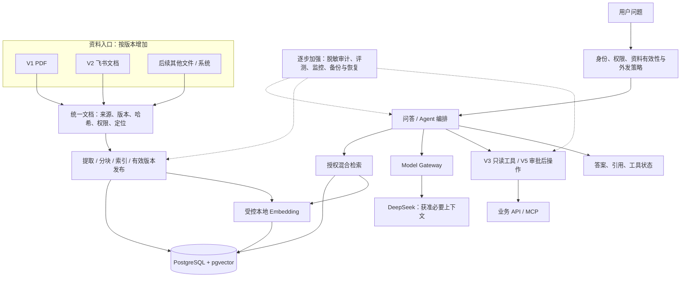

# 企业 Agent 平台 · 架构升级计划

**核心要点：** 业务版本逐步增加能力，部署架构按证据升级。企业级首先是正确授权、可追溯、可恢复和可运营，不是组件数量。

更新日期：2026-11-06。版本定义以 [迭代路线](../plans/iteration-roadmap.md) 为准；本文为升级建议，具体资源、组件、阈值与采购尚未确认，没有运行验证结果。

## 1. 三个架构形态

| 形态 | 对应版本 | 默认结构 | 何时适用 |
| --- | --- | --- | --- |
| 本地闭环 | V1 | 模块化应用、PostgreSQL + pgvector、本地 Embedding、受控文件目录 | 少量无敏感 PDF、单人本机验证 |
| 受控试点 | V2～V3 | 复用核心，增加来源连接器、持久同步任务、可信身份、策略与工具边界 | 获准真实资料和用户；需真实权限、加密和审计 |
| 企业运营 | V4～V6 | 受控云环境、私有存储、监控备份、灰度和质量治理；按需独立 Worker / 业务域 | 有确认的服务目标、预算、运维责任和隔离要求 |

模块不自动等于独立服务。数据库与本地向量模型可以独立运行，但不因此把业务拆成微服务。

## 2. 从第一版就保留的接口

| 边界 | 最小职责 | 不提前建设的内容 |
| --- | --- | --- |
| 文档入口 | 输出来源类型 / ID、版本、哈希、可见范围、内容和来源定位 | 通用插件市场、复杂连接器 SDK |
| 索引 | 可追溯分块，继承文档权限及模型指纹，发布有效版本 | 多套搜索引擎、任意索引 DSL |
| 模型 | 网关管理凭据、外发策略、超时和脱敏调用摘要 | 多模型智能调度和未经批准的新供应商 |
| 文件 | 通过存储引用及授权读取，不绑定业务绝对路径 | 提前采购 OSS、直接公开文件目录 |
| 工具 | 可信身份、允许清单、参数和逐次授权 | V1 就做 MCP；允许模型执行任意 SQL |
| 审计与任务 | 稳定事件 / 任务 ID、时间和版本；按实际版本实现 | 声称已有完整备份、引入无需求的队列 |

这些是减少未来返工的有限边界，不要求第一版实现所有扩展。

## 3. 关键升级选择

安全与合规是硬约束。继续现有组件能够解决问题时，优先比较局部优化，不直接新增服务。

| 升级点 | 方案 A | 方案 B | 当前建议、代价与反转条件 |
| --- | --- | --- | --- |
| 应用框架（V1） | Next.js 同工程，网页和接口一起维护 | React + Vite、Fastify，前后端分别运行 | A 为候选；初期配置少，但需避免长任务阻塞。若当前就需要独立部署或团队分工，选择 B；尚未确认 |
| 导入运行（V2） | 持久任务登记后共部署执行 | 独立 Worker 读取持久任务 | 先比较 A 的重启恢复和问答影响；独立运行降低资源争用但增加部署和任务协调。导入反复拖慢问答时升级 B |
| 云数据库（V4） | 阿里云托管 PostgreSQL | 自管 PostgreSQL | 先比较托管版本 / pgvector、网络、备份和总费用；自管控制更强但自行承担升级恢复。未核查具体产品与价格，不提前拍板 |
| 存储（V4） | 本地受控盘配加密备份 | 私有 OSS 及授权读取 | 多实例和远程可用性通常推动 B；对象存储增加费用与迁移校验，适配器不替代备份。具体配置待确认 |
| 权限域（V6） | 共享平台，强制逻辑隔离 | 独立实例 / 数据库及存储 | A 复用高但隔离与资源争用必须证明；监管要求或故障隔离不可满足时选择 B，承担重复运维 |
| 检索规模（持续） | PostgreSQL + pgvector 的索引和查询优化 | 专用搜索 / 向量服务 | 先用同批资料验证 A；只有性能或功能瓶颈才比较 B。B 增加一致性和权限维护，不因文档数量猜测而迁移 |
| 回答质量（持续） | 改善解析、分块、分词和 RRF | 独立语义重排序模型 | 先分辨 PDF 提取、证据召回与生成错误；B 仅在同条件改善效果且延迟资源可接受时考虑 |
| 同步时效（持续） | 定时增量 + 授权失效阻断 | 事件驱动 + 定期核对 | A 简单但不能容忍越权窗口；B 增加事件丢失、乱序与补偿处理。时效目标不能满足时比较 B |
| 办理流程（V5） | 对接已有审批，维护明确操作状态 | 引入独立流程引擎 | 先做一个获准低风险操作；跨系统长流程和补偿需求明确后再比较 B，不提前自建流程平台 |
| 服务协作（V6） | 模块化应用 / 单 Agent 加工具 | 服务拆分 / 多 Agent | A 易追踪权限和失败；B 增加网络、协调与审计成本，仅在独立扩容或职责确需协作时考虑 |

目前以上内容是路径比较与条件建议，不包含供应商能力、兼容版本、价格或性能的已验证结论。选型前查官方资料，记录核查日期、许可及限制。

## 4. 每次升级的最小验证

1. **写清问题**：哪个场景、哪类用户、多少数据、什么并发与哪条指标未满足；没有数据先采样。
2. **确认目标和预算**：业务 / 安全 / 运维负责人确认验收口径、观察窗口、资源及费用上限。
3. **同条件比较**：保持语料、权限、模型、并发和缓存条件一致，记录硬件、版本、费用和全部失败。
4. **先证明硬约束**：越权、高敏外发、敏感日志泄露任一次失败就不能推广；高正确率不能抵消泄露。
5. **再证明收益**：质量、p95、错误率、同步时效或资源成本确实改善，接受新增的维护负担。
6. **批准并灰度**：在本规划中更新当前选择、迁移、回退与数据风险，由用户授权实施，再扩大范围。

阈值必须结合真实工作负载确认；不把集团人数当并发，不把演示成功当容量结论。

## 5. 迁移与回退清单

| 迁移 | 实施次序 | 验证与回退限制 |
| --- | --- | --- |
| 增加资料入口 | 注册来源与授权 → 隔离导入 → 核对版本 / ACL → 发布 → 开放入口 | 可停连接器和新来源；保留原 PDF。权限异常先不可用，不能改成共享 |
| 飞书身份接入 | 映射用户 / 群组 → 绑定文件 ACL → 验证有效权限 → 开放获准试点 | 未映射默认拒绝；不允许固定演示身份出现在真实用户请求中 |
| 独立 Worker | 持久任务与幂等 → 停旧执行器 → 新 Worker 接管 → 验证重启恢复 | 同一任务不重复发布；回退先停止新消费者并核对运行中状态 |
| 更换向量模型 | 锁定新模型与指纹 → 生成独立新索引 → 同条件评测 → 切流 → 保留受控旧索引 | 不混用维度、模型和输入约定；旧索引也要处理撤权 / 删除。保留周期与计算成本另行确认 |
| 更换搜索系统 | 导出一致版本 / ACL → 建新索引 → 对照查询 → 小流量切换 → 核对一致性 | 新系统任何未授权召回都禁止发布；源数据仍以权威数据库 / 来源为准 |
| 本地迁云 | 确认网络与合规 → 备份恢复演练 → 数据 / 文件迁移 → 核对哈希和权限 → 灰度 | 明确唯一写入位置。切换时暂停变更或设计获准增量迁移；有云端新数据不能切回旧快照 |
| 增加业务写入 | 明确对象和操作 → 审批 / 确认 → 当前授权 → 幂等执行 → 状态与审计 | 默认关闭；超时先查状态。撤销部署不撤销已完成业务操作 |
| 多域扩展 | 明确域与身份 → 数据 / 工具 / 会话等隔离 → 验证跨域拒绝 → 灰度新域 | 任一隔离失败停用新域；独立实例迁移需核对身份、日志和备份权限 |

生产备份应覆盖数据库、原文件、审计、必要配置与版本对应关系，密钥单独管理。索引是否从备份恢复还是重建需记录时间与成本；恢复演练同时验证权限和引用，不只验证进程可启动。

## 6. 责任、运行目标与费用

| 角色 | 需要确认什么 |
| --- | --- |
| 业务负责人 | 场景、事实来源、误答 / 误操作后果、试点范围、质量目标 |
| 安全负责人 | 资料授权、模型外发、身份权限、保留删除、备份与隔离 |
| 技术负责人 | 接口、数据兼容、依赖许可、验证证据与迁移方案 |
| 运维负责人 | 并发、p95、错误率、容量、告警、恢复目标和故障责任 |
| 项目负责人 / 用户 | 优先级、资源预算、接受的技术债和具体执行授权 |

人员尚未指定。V1 仅记录本地资源和调用用量；V4 上线前确认恢复时长与可接受数据丢失量，并演练证明。每次升级估算 API、计算 / 模型、数据库、文件、网络、监控、备份、人工维护和迁移费用，不能只比较模型单价。

## 7. 当前状态

所有升级实验、迁移、生产验证均未执行。下一项是确认并实现 V1，不是部署完整目标架构。本文与 [总体架构](overview.md)、[架构图](project-architecture.md) 配套使用；当前技术选择与待确认项直接在这组规划文档中维护。
