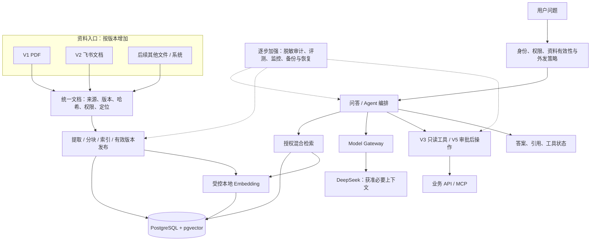
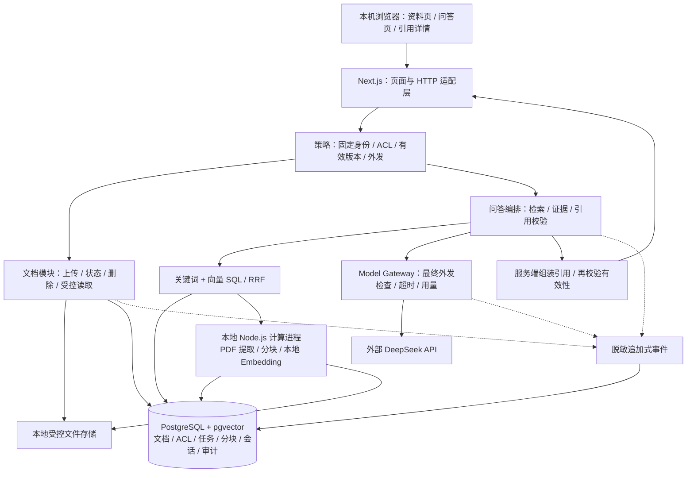

# 企业 Agent 平台 · 架构升级计划

**核心要点：** 业务版本逐步增加能力，部署架构按证据升级。企业级首先是正确授权、可追溯、可恢复和可运营，不是组件数量。

更新日期：2026-11-09。版本定义以 [迭代路线](../plans/iteration-roadmap.md) 为准；V1 网页工程初始化已验证，数据库 / PDF / 模型集成未验证，后续资源、阈值与采购仍为建议。

## 1. 三个架构形态

| 形态 | 对应版本 | 默认结构 | 何时适用 |
| --- | --- | --- | --- |
| 本地闭环 | V1 | 模块化应用、PostgreSQL + pgvector、本地 Embedding、受控文件目录 | 少量无敏感 PDF、单人本机验证 |
| 受控试点 | V2～V3 | 复用核心，增加来源连接器、持久同步任务、可信身份、策略与工具边界 | 获准真实资料和用户；需真实权限、加密和审计 |
| 企业运营 | V4～V6 | 受控云环境、私有存储、监控备份、灰度和质量治理；按需独立 Worker / 业务域 | 有确认的服务目标、预算、运维责任和隔离要求 |

模块不自动等于独立服务。数据库与本地向量模型可以独立运行，但不因此把业务拆成微服务。



## 2. 从第一版就保留的接口

| 边界 | 最小职责 | 不提前建设的内容 |
| --- | --- | --- |
| 文档入口 | 输出来源类型 / ID、版本、哈希、可见范围、内容和来源定位 | 通用插件市场、复杂连接器 SDK |
| 索引 | 可追溯分块，继承文档权限及模型指纹，发布有效版本 | 多套搜索引擎、任意索引 DSL |
| 模型 | 网关管理凭据、外发策略、超时和脱敏调用摘要 | 多模型智能调度和未经批准的新供应商 |
| 文件 | 通过存储引用及授权读取，不绑定业务绝对路径 | 提前采购 OSS、直接公开文件目录 |
| 工具 | 可信身份、允许清单、参数和逐次授权 | V1 就做 MCP；允许模型执行任意 SQL |
| 审计与任务 | 稳定事件 / 任务 ID、时间和版本；按实际版本实现 | 声称已有完整备份、引入无需求的队列 |

这些是减少未来返工的有限边界，不要求第一版实现所有扩展。

## 3. 关键升级选择

安全与合规是硬约束。继续现有组件能够解决问题时，优先比较局部优化，不直接新增服务。

| 升级点 | 方案 A | 方案 B | 当前建议、代价与反转条件 |
| --- | --- | --- | --- |
| 应用框架（V1） | Next.js 同工程，网页和接口一起维护 | React + Vite、Fastify，前后端分别运行 | A 已确认，网页骨架已验证；初期配置少，但需避免长任务阻塞。独立部署或团队分工成为实际需求时重新比较 B |
| 导入运行（V2） | 持久任务登记后共部署执行 | 独立 Worker 读取持久任务 | 先比较 A 的重启恢复和问答影响；独立运行降低资源争用但增加部署和任务协调。导入反复拖慢问答时升级 B |
| 云数据库（V4） | 阿里云托管 PostgreSQL | 自管 PostgreSQL | 先比较托管版本 / pgvector、网络、备份和总费用；自管控制更强但自行承担升级恢复。未核查具体产品与价格，不提前拍板 |
| 存储（V4） | 本地受控盘配加密备份 | 私有 OSS 及授权读取 | 多实例和远程可用性通常推动 B；对象存储增加费用与迁移校验，适配器不替代备份。具体配置待确认 |
| 权限域（V6） | 共享平台，强制逻辑隔离 | 独立实例 / 数据库及存储 | A 复用高但隔离与资源争用必须证明；监管要求或故障隔离不可满足时选择 B，承担重复运维 |
| 检索规模（持续） | PostgreSQL + pgvector 的索引和查询优化 | 专用搜索 / 向量服务 | 先用同批资料验证 A；只有性能或功能瓶颈才比较 B。B 增加一致性和权限维护，不因文档数量猜测而迁移 |
| 回答质量（持续） | 改善解析、分块、分词和 RRF | 独立语义重排序模型 | 先分辨 PDF 提取、证据召回与生成错误；B 仅在同条件改善效果且延迟资源可接受时考虑 |
| 同步时效（持续） | 定时增量 + 授权失效阻断 | 事件驱动 + 定期核对 | A 简单但不能容忍越权窗口；B 增加事件丢失、乱序与补偿处理。时效目标不能满足时比较 B |
| 办理流程（V5） | 对接已有审批，维护明确操作状态 | 引入独立流程引擎 | 先做一个获准低风险操作；跨系统长流程和补偿需求明确后再比较 B，不提前自建流程平台 |
| 服务协作（V6） | 模块化应用 / 单 Agent 加工具 | 服务拆分 / 多 Agent | A 易追踪权限和失败；B 增加网络、协调与审计成本，仅在独立扩容或职责确需协作时考虑 |

目前以上内容是路径比较与条件建议，不包含供应商能力、兼容版本、价格或性能的已验证结论。选型前查官方资料，记录核查日期、许可及限制。

## 4. 每次升级的最小验证

1. **写清问题**：哪个场景、哪类用户、多少数据、什么并发与哪条指标未满足；没有数据先采样。
2. **确认目标和预算**：业务 / 安全 / 运维负责人确认验收口径、观察窗口、资源及费用上限。
3. **同条件比较**：保持语料、权限、模型、并发和缓存条件一致，记录硬件、版本、费用和全部失败。
4. **先证明硬约束**：越权、高敏外发、敏感日志泄露任一次失败就不能推广；高正确率不能抵消泄露。
5. **再证明收益**：质量、p95、错误率、同步时效或资源成本确实改善，接受新增的维护负担。
6. **批准并灰度**：在本规划中更新当前选择、迁移、回退与数据风险，由用户授权实施，再扩大范围。

阈值必须结合真实工作负载确认；不把集团人数当并发，不把演示成功当容量结论。

## 5. 迁移与回退清单

| 迁移 | 实施次序 | 验证与回退限制 |
| --- | --- | --- |
| 增加资料入口 | 注册来源与授权 → 隔离导入 → 核对版本 / ACL → 发布 → 开放入口 | 可停连接器和新来源；保留原 PDF。权限异常先不可用，不能改成共享 |
| 飞书身份接入 | 映射用户 / 群组 → 绑定文件 ACL → 验证有效权限 → 开放获准试点 | 未映射默认拒绝；不允许固定演示身份出现在真实用户请求中 |
| 独立 Worker | 持久任务与幂等 → 停旧执行器 → 新 Worker 接管 → 验证重启恢复 | 同一任务不重复发布；回退先停止新消费者并核对运行中状态 |
| 更换向量模型 | 锁定新模型与指纹 → 生成独立新索引 → 同条件评测 → 切流 → 保留受控旧索引 | 不混用维度、模型和输入约定；旧索引也要处理撤权 / 删除。保留周期与计算成本另行确认 |
| 更换搜索系统 | 导出一致版本 / ACL → 建新索引 → 对照查询 → 小流量切换 → 核对一致性 | 新系统任何未授权召回都禁止发布；源数据仍以权威数据库 / 来源为准 |
| 本地迁云 | 确认网络与合规 → 备份恢复演练 → 数据 / 文件迁移 → 核对哈希和权限 → 灰度 | 明确唯一写入位置。切换时暂停变更或设计获准增量迁移；有云端新数据不能切回旧快照 |
| 增加业务写入 | 明确对象和操作 → 审批 / 确认 → 当前授权 → 幂等执行 → 状态与审计 | 默认关闭；超时先查状态。撤销部署不撤销已完成业务操作 |
| 多域扩展 | 明确域与身份 → 数据 / 工具 / 会话等隔离 → 验证跨域拒绝 → 灰度新域 | 任一隔离失败停用新域；独立实例迁移需核对身份、日志和备份权限 |

生产备份应覆盖数据库、原文件、审计、必要配置与版本对应关系，密钥单独管理。索引是否从备份恢复还是重建需记录时间与成本；恢复演练同时验证权限和引用，不只验证进程可启动。

## 6. 责任、运行目标与费用

| 角色 | 需要确认什么 |
| --- | --- |
| 业务负责人 | 场景、事实来源、误答 / 误操作后果、试点范围、质量目标 |
| 安全负责人 | 资料授权、模型外发、身份权限、保留删除、备份与隔离 |
| 技术负责人 | 接口、数据兼容、依赖许可、验证证据与迁移方案 |
| 运维负责人 | 并发、p95、错误率、容量、告警、恢复目标和故障责任 |
| 项目负责人 / 用户 | 优先级、资源预算、接受的技术债和具体执行授权 |

人员尚未指定。V1 仅记录本地资源和调用用量；V4 上线前确认恢复时长与可接受数据丢失量，并演练证明。每次升级估算 API、计算 / 模型、数据库、文件、网络、监控、备份、人工维护和迁移费用，不能只比较模型单价。

## 7. 当前状态

V1 网页工程初始化完成，本机生产模式启动已验证；数据库 / PDF / 模型兼容实验、迁移与企业生产验证未执行。下一项须由用户指定，不部署完整目标架构。本文与 [总体架构](overview.md)、[架构图](project-architecture.md) 配套使用。

## 8. V1 技术架构方案

**目标**：本机单人使用 3～5 份获准、无敏感信息的文字型 PDF，完成上传、持久入库、问答和可核对的页码引用。

**方案状态**：2026-11-09 已确认 A：Next.js 同工程 + 本地轻量计算进程；用户仅授权工程初始化 2.1～2.3 及本阶段依赖安装，网页骨架已交付。既有检索与模型路线不变；计算进程、PDF / 模型依赖与业务参数尚未验证，不授权建库、模型下载或 API 费用。具体版本和结果见 [工程与兼容验证计划](../plans/2026-11-07-v1-engineering-compatibility.md)。

### 8.1 路线复核与补充建议

V1～V6 顺序合理，不新增版本，也不把生产治理全部提前。补充四项首版细节：

1. **导入可恢复**：上传先登记持久任务，处理不依赖浏览器连接；进程重启后能识别未完成任务，不能留下永久“处理中”。
2. **中文质量先验证**：先检查 PDF 提取顺序、中文分词、模型输入与证据召回，再优化回答提示词；不可把检索到内容等同于答案有依据。
3. **引用与删除一致**：引用绑定文件、版本、页码和分块；删除立刻阻断检索与读取，处理中的任务不能重新发布已删除文档。
4. **运行边界可配置**：上传大小、页数、处理时限、模型请求时限及调用上限有明确配置和失败提示；V1 不承诺生产 SLA。

来源冲突时展示相关来源并说明差异，不让模型自行认定哪份 PDF 是权威版本。V1 不做自动跨文件版本合并。

### 8.2 场景与安全前提

| 项目 | V1 方案 |
| --- | --- |
| 用户与规模 | 固定演示身份、本机单人、3～5 份 PDF；硬件与实际页数在实施时记录 |
| 输入与输出 | 文字型 PDF、问题；文档状态、答案、引用、物理页码、提取原文 |
| 权威来源 | 用户选定的演示 PDF；正文以指定版本原文件为准，提取文本供核对 |
| 时效 | 手动上传；只有全部索引准备完成的版本可检索，删除后立即不可用 |
| 权限 | 文件显式绑定演示身份；未配置 ACL 默认拒绝，不信任客户端传入身份 |
| 外发 | 仅发送获准问题与必要证据；整份文件、本地路径、凭据不发给 DeepSeek |
| 风险与故障 | 只做资料问答；无依据、解析异常、模型失败和引用失效均有明确状态 |
| 排除范围 | OCR、复杂表格、飞书、多用户、实时工具、办理、云部署、生产自动备份体系 |

所有应用入口仅监听回环地址，演示模式有显式开关；若改为远程访问，必须停止按 V1 安全假设使用。回环访问也需校验 Origin/Host、限制跨域和保护写请求，避免其他网页借浏览器调用本地上传或删除接口。

外发策略采用“显式获准演示资料 + 问题检查 + 默认拒绝未知密级”的边界。敏感模式检测只是辅助，不能证明任意输入无敏感信息，也不作为放行严格受限内容的依据。

### 8.3 应用与计算部署选择

| 对比维度 | A：Next.js + 同工程计算进程 | B：React/Vite + Fastify + 计算进程 |
| --- | --- | --- |
| 数据流 | 同源网页与 Route Handlers；服务端调用内部计算接口及数据库 | 网页调用独立 API；API 调用计算接口及数据库 |
| 场景适配 | 本机单人、小规模 PDF，当前一个工程逐步落地 | 已有前后端团队分工、API 需独立部署或服务多个客户端 |
| 收益与代价 | 减少网页/API 工程配置；仍需管理计算进程，受 Next.js 运行与构建约束 | 后端生命周期明确；增加两个工程的配置、契约及跨域/代理维护 |
| 正确性与安全 | Node.js 服务端执行授权，重计算不放在请求生命周期；文件接口不缓存 | API 集中执行相同授权；不得因跨域拆分弱化身份及文件策略 |
| 开发与维护 | 路由只做参数、身份和结果映射，业务模块与框架分离 | 更清晰的独立部署，但首版需协调前后端构建和服务契约 |
| 性能与费用 | PDF/向量计算隔离；无实测性能结论，无云资源费用 | 同样隔离计算；首版不预期框架拆分本身改善召回或模型费用 |
| 阶段适用性 | V1；后续可将业务接口迁至独立 API | 当前已有独立后端需求，或后续实测证明有必要 |
| 迁移代价 | 移动 HTTP 适配层、重新校验身份与接口；计算和数据库模块复用 | 前期多维护工程；合回单工程仍需调整路由与部署 |
| 证据与验证 | 官方确认 Route Handlers 支持请求处理；生产构建、启动和任务恢复待测 | 属于可行替代提案；具体依赖、构建与集成尚未核查 |

**推荐 A**：当前没有独立 API 部署需求，优先减少工程数量；不是因为需要 SSR 或 SEO。Next.js 不承载长时间 PDF 处理，不采用 Edge Runtime，不依赖请求返回后继续执行的内存任务。

**计算进程选择**：同进程处理省一个启动项，但解析和推理会争用应用资源，开发热更新也会影响模型与任务生命周期。建议同仓库启动一个 Node.js 计算进程，持有模型实例、处理 PDF 并读取数据库任务；它不是独立业务微服务，不引入 Redis 或消息队列。代价是多一个进程、内部接口和故障检查。

**反转条件**：若团队当前要求独立后端、其他客户端或独立 API 发布，则改选 B；若本地计算进程的兼容性或资源占用不可接受，先比较线程或 Python 运行方式，不扩大首版范围。

### 8.4 首版部署图与模块职责



- **网页/API**：接收短请求、校验输入和身份、返回状态；不把模型密钥或存储路径给浏览器。
- **计算进程**：单次领取一个导入任务，有限批次推理；查询向量和导入共享模型实例，查询优先在批次边界执行，不并行无限加载模型。
- **内部通信**：计算接口仅回环监听，使用独立内部凭据；不接受用户指定文件路径或任意 URL。任务由数据库领取，不通过内部请求携带整份 PDF。
- **数据库**：元数据、权限、持久任务与有效索引的权威登记；无需另建任务平台。
- **适配器**：只保留 PDF 提取、Embedding、模型和文件四个小契约，不建设通用插件系统。

计算进程故障时网页仍可展示已有资料及失败状态，向量查询不可用则明确说明，V1 不悄悄切换为另一种检索模式并宣称结果等价。

### 8.5 导入与发布链路

```text
流式校验上传大小与文件类型 → 临时受控文件 → 内容哈希
→ 登记文档、显式 ACL 与持久任务 → 返回文档 ID
→ 计算进程领取任务 → 按物理页提取文字 → 页内分块
→ 中文分词与本地向量 → 写入待发布版本
→ 事务核对文档未删除、任务租约与索引完整 → 发布 ready
```

建议状态：文档 `queued / processing / ready / failed / deleted`；任务 `queued / running / succeeded / failed / cancelled`。页面展示可读失败原因，原始异常与文件正文不直接写入日志。

- 上传扩展名、媒体类型及文件签名联合校验；解析超时、加密 PDF、损坏 PDF、无可提取文字均不发布。
- 混合扫描/文字 PDF 逐页标记提取质量；发现无文字页给出部分内容缺失警告，不能称整份文件已完整理解。
- 分块不跨物理页，保留页内段落顺序、文本偏移、提取器版本；页码从 1 开始，明确不是印刷页码。
- 建议初始分块目标约 300 tokens、重叠约 50 tokens，以实际 tokenizer 检查上限及特殊 token；这是调试起点，不是最佳参数结论。
- 重复识别在同一演示所有者范围按内容哈希约束；相同名称不同内容是不同文档，重复上传返回已有状态而非重复索引。
- 任务保存尝试次数、租约、心跳与错误码；租约到期可重新领取，每次发布校验执行令牌，旧执行器不得覆盖新结果。
- 重试按文档版本与分块序号幂等写入；V1 可从该任务起点重新处理，不做复杂分块断点续传。
- 文件与数据库不是同一事务：临时文件失败清理、未关联文件核对、任务创建失败清理必须测试，不宣称跨存储原子提交。
- 删除先事务性停用文档并取消任务，再清理文件和派生索引；清理失败保持不可读并记录待重试状态。审计摘要不因文档删除而改写。

### 8.6 检索、回答与引用链路

1. 服务端取得固定身份，检查问题外发策略与选中文档范围，不接受任意客户端 ACL。
2. 同一中文分词契约处理正文和问题，保留产品名、编号及错误码；将分词结果写入 PostgreSQL `simple` 全文配置，查询参数化生成，不直接拼接 `tsquery`。
3. 两路 SQL 都联结当前文档、ACL、可用版本和外发许可；关键词召回与余弦向量召回各取候选后按分块 ID 融合。
4. 建议起点为每路 20 个候选、RRF 的 `k=60`、最多 5 个证据块；小语料先使用精确向量排序，暂不增加 ANN 索引。数字待演示题验证，不是容量承诺。
5. RRF 分值不是证据充分度或置信概率；无候选直接返回无依据。有候选仍检查其能否回答问题，允许模型明确拒答。
6. 给证据分配服务端 ID，发送必要问题和片段；不默认发送全部会话历史。V1 每轮基于当前问题重新检索，不交付长期 Memory。
7. 网关最后核对外发许可、文档当前状态与配置预算，再请求结构化答案、是否有依据及证据 ID；不启用边生成边展示，先校验再返回。
8. 服务端校验结构及证据 ID，只从数据库组装文件名、版本、页码和原文；未知 ID、空输出、截断或无依据输出不能作为正常答案发布。
9. 返回前再次检查来源可用性；引用详情和原文件读取各自重新检查权限与版本，旧会话只能显示“来源已不可用”，不能继续展示已删原文。

**引用校验的边界**：ID 和页码正确只能证明来源存在，不能自动证明答案每句话受原文支持。V1 必须逐题人工核对事实与证据；发现无支持断言时记录失败并修正，不能宣称实现了可靠的全自动事实核验。

文档内容只作为证据，恶意 PDF 里的“忽略规则”不产生权限。Markdown 输出关闭原始 HTML及不安全链接；文件读取使用不透明文档 ID，存储路径由服务端解析。

### 8.7 数据结构与代码组织

| 数据实体 | 最小字段与约束 |
| --- | --- |
| `documents` | ID、来源类型/ID、所有者、文件名、哈希、存储引用、状态、密级、外发许可、当前有效版本、页数 |
| `document_versions` | 文档 ID、版本 ID、内容哈希、解析/分块/分词版本、模型指纹、发布状态与时间 |
| `document_acl` | 文档 ID、主体 ID、读取许可；V1 只实现固定演示主体，不造组织体系 |
| `ingestion_jobs` | 文档/版本 ID、状态、尝试次数、租约、执行令牌、心跳、错误码与时间 |
| `chunks` | 分块/版本 ID、物理页码、页内序号与偏移、正文、`tsvector`、向量与模型指纹 |
| `sessions / messages` | 会话 ID、脱敏问题/回答、结果状态、引用 ID、时间；读取引用仍依赖当前权限 |
| `audit_events` | 事件/会话/请求 ID、时间、格式版本、类型、操作者与脱敏摘要；应用角色只允许追加 |

文档权限不复制成独立分块 ACL，查询通过文档关系继承，减少修改后残留旧权限。文档、版本、任务和分块具备外键与唯一约束，发布在同一数据库事务完成。

模型指纹包含权重 revision/hash、tokenizer、向量维度、pooling、归一化、量化方式和问题前缀；不匹配时禁止查询旧向量。确定模型后才创建具体 `vector(n)` 迁移，不能先假定任意维度兼容。

建议工程路径（未创建）：

```text
src/app/                         页面与 HTTP 路由，保持薄层
src/views/documents/             上传、文档状态、引用详情
src/views/chat/                  问答与来源展示
src/components/                 真正跨功能的全局组件
src/modules/documents/           导入、生命周期、删除与受控读取
src/modules/retrieval/           分词、两路 SQL、RRF 与证据选择
src/modules/chat/                问答编排、消息与引用校验
src/modules/policy/              演示身份、ACL、外发与输出安全
src/modules/audit/               追加事件与脱敏
src/adapters/                    PDF、Embedding、DeepSeek、文件存储
src/compute/main.ts              计算进程启动、任务领取与内部接口
src/db/migrations/               版本化 SQL 与权限配置
tests/integration/               数据库、发布、删除与任务恢复
tests/e2e/                       演示 PDF 主链路与故障验收
```

各功能的单元测试与对应模块相邻；不在框架路由里写检索 SQL 或供应商调用。不新增未使用的连接器、工具或云服务目录。

### 8.8 依赖候选与最小兼容性实验

| 能力 | 建议与替代 | 验证及退出代价 |
| --- | --- | --- |
| PDF 提取 | 候选 `pdfjs-dist`；轻量封装库可作为替代 | 比较中文、换行、阅读顺序和页码；后端 Node.js 运行、字体/CMap 资源待验证，更换提取器需重建分块 |
| 本地 Embedding | 候选 BGE small 中文模型 + Transformers.js/ONNX；替代为本地 Python/FlagEmbedding | JS 减少语言与环境数量，但 ONNX 制品及输入对齐必须核实；Python 更接近官方模型示例，但增加环境与进程契约 |
| 中文分词 | 候选受维护的 Jieba/WASM 实现；字符 n-gram 仅作比较基线 | 比较词语、同义表达、编号与英文混排，核查许可、字典、Node.js 打包；更换后重建关键词索引 |
| 数据访问 | 候选 `pg` + 版本化参数化 SQL；ORM 可另比较 | 便于表达 pgvector 和一致 ACL；代价是手动维护迁移、类型与 SQL 测试 |
| 模型调用 | 服务端封装 DeepSeek HTTP API，模型 ID 配置化 | 不假定固定型号永久可用；锁定实际获准型号与输出能力，空 JSON 和超时均测试 |
| 测试 | 候选 Vitest + 浏览器端到端测试 | 单元、真实数据库、真实本地模型和真实 API 的结果分别登记，mock 不等于集成通过 |

**实施前实验**：用一份中文文字 PDF、一份编号/英文混排 PDF 和一份含扫描页 PDF；先提取人工选定的页，核对页码与原文，再对约 10 题检查证据进入 Top-5 的情况。记录本机硬件、内存、冷启动、热查询耗时和所有失败。

本地模型必须验证 tokenizer、CLS pooling、归一化与问题前缀，不能沿用任意 feature-extraction 默认平均池化。BGE 模型卡建议检索问题可加前缀、正文不加；最终约定按本任务对比结果锁定。

运行期禁用自动远程加载模型；首次下载属于待授权的依赖准备，须登记来源、revision、哈希及许可。候选 BGE 模型卡标注 MIT，不代表第三方 ONNX 制品和全部依赖已完成许可核查。

**证据记录（核查日期 2026-11-06）**：

- [Next.js Route Handlers](https://nextjs.org/docs/app/getting-started/route-handlers)：确认网页工程内 HTTP 处理能力，不证明长任务生命周期可靠。
- [PDF.js 官方入门](https://mozilla.github.io/pdf.js/getting_started/)：确认解析、显示与查看器的职责；不证明具体中文 PDF 提取质量。
- [Transformers.js Node.js](https://huggingface.co/docs/transformers.js/en/tutorials/node)：确认服务端推理、本地模型路径和禁止远程加载配置；不证明所选 BGE ONNX 制品兼容。
- [BGE 中文模型卡](https://huggingface.co/BAAI/bge-small-zh-v1.5)：确认候选模型、输入约定、CLS 与归一化说明；未进行本机推理。
- [PostgreSQL 全文配置](https://www.postgresql.org/docs/current/textsearch-configuration.html)：确认 parser/dictionary 与 `tsvector` 配置机制；应用中文分词效果待测。
- [DeepSeek JSON Output](https://api-docs.deepseek.com/guides/json_mode)：说明结构化输出及可能空内容；合法 JSON 不等于事实、引用或应用 schema 正确。

安装时另核对 Node.js、Next.js、PDF.js、运行库与 PostgreSQL/pgvector 的实际版本兼容，锁文件固定版本；本方案不把官网当前版本直接当作项目锁定版本。

### 8.9 审计、资源与验收

V1 实现最小脱敏追加事件：上传、任务状态、提问摘要、检索来源 ID、策略决定、模型调用状态/用量、回答结果、引用读取和删除。禁止保存密钥、认证头、原始敏感问题、整段模型请求或异常中的敏感正文；对会话内容同样执行脱敏和受控读取。

生产级自动备份、加密密钥生命周期及企业审计同步仍按原路线推进；V1 使用无敏感演示资料，至少验证重启持久性并提供本地数据导出/恢复步骤，不宣称已满足企业恢复目标。任何真实资料启用前重新落实加密、授权和受控备份要求。

本地受控数据目录放在代码/Git 之外，环境文件与凭据不提交。建议上传上限 20 MiB、200 页，问答超时 60 秒、导入超时 10 分钟、单个模型请求至多 1 次受控瞬时故障重试；均为可调整初值，不代表本机性能或供应商保证。身份/参数错误不重试；总调用次数包含失败与重试。

DeepSeek 联调前确认模型 ID、费用上限及限流配置，未设置预算不启用调用；计入问题、片段、输出和重试用量，不引用未经核实的单价。本地磁盘、内存和模型冷启动成本也记录，但不购买云资源。

验收对应路线 V1：

- 三份文字 PDF 发布成功，重启后原文件、状态和问答索引仍一致。
- 约十题逐题记录证据召回、事实支持、页码及原文；未通过题保留失败，不包装成正式评测成绩。
- 无答案题明确无依据；来源冲突有提示；未知引用 ID、空/坏模型输出不显示正常答案。
- 重复上传、解析失败、混合扫描页、处理中重启、处理中删除均有确定结果。
- 删除后新检索、旧引用、历史会话重新取原文均不可读取；任务重试不能复活文档。
- 问题高敏阻断、缺失 ACL、恶意 PDF 指令、日志脱敏与本地跨站写请求具备安全回归；任一泄露失败不通过。
- 真实本地模型和 DeepSeek 联调独立记录；只有 mock 通过时明确标注未完成真实链路。

### 8.10 确认与实施顺序

**已确认决策**：采用 A：Next.js 同工程 + 本地轻量计算进程。计算进程尚未实现；模型/分词/解析库先实验后锁定，结果不合格时重新比较，不默认更换供应商。

**执行约定**：本节仅为规划；用户确认架构并指定步骤后执行。每步先写失败测试，再实现并验证；只更新当前路线与架构的状态，不创建额外历史计划，不自动提交或推送。

| 步骤 | 交付与预计涉及路径 | 通过依据 |
| --- | --- | --- |
| 1. 工程与兼容验证 | `package.json`、配置、`src/compute/`、`src/adapters/`、`src/db/migrations/`，更新 README | 构建启动、pgvector 查询、中文 PDF 页提取、本地向量一致性；锁定依赖和运行约定 |
| 2. PDF 入库闭环 | `src/modules/documents/`、`src/modules/policy/`、`src/modules/audit/`、文档页及集成测试 | 上传、显式权限、持久任务、发布、重复、重启恢复、删除与清理失败测试 |
| 3. 问答与来源闭环 | `src/modules/retrieval/`、`src/modules/chat/`、模型适配器、问答/引用页与测试 | 两路前置过滤、RRF、证据不足、网关失败、结构化输出和引用再授权 |
| 4. 演示验收与使用说明 | `tests/e2e/`、README、当前路线验收记录 | 三份 PDF、约十题、必要安全与失败场景、真实链路及资源/用量记录 |

- [x] 架构选项确认，指定首个执行步骤：工程初始化 2.1～2.3。
- [ ] 步骤 1：工程与兼容验证。
- [ ] 步骤 2：PDF 入库闭环。
- [ ] 步骤 3：问答与来源闭环。
- [ ] 步骤 4：演示验收与使用说明。

已完成工程初始化 2.1～2.3：5 个页面测试、类型检查、lint、构建及开发 / 生产浏览器启动通过。总步骤 1 仍未完成，数据库、PDF、本地模型和计算进程须另行实施与验收。
