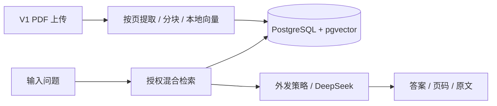
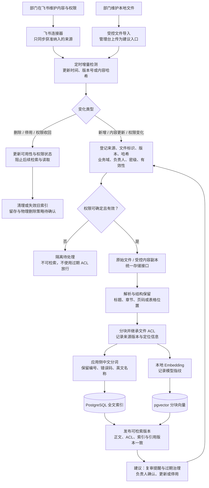
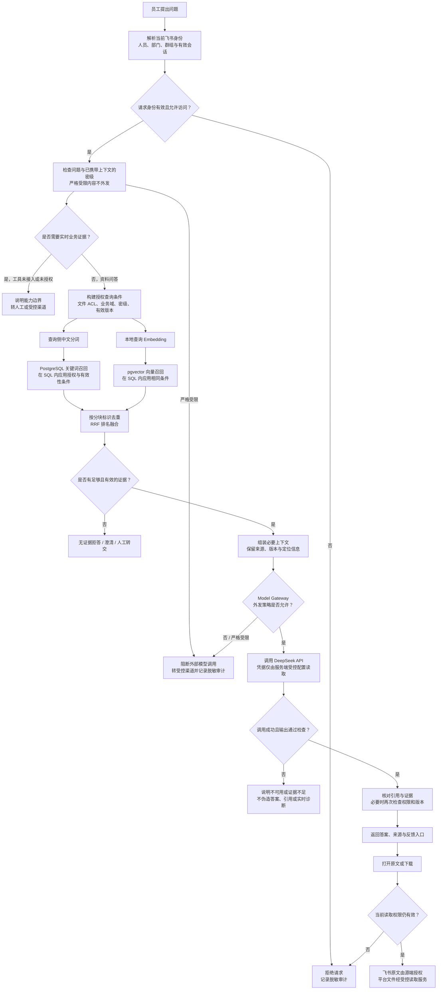
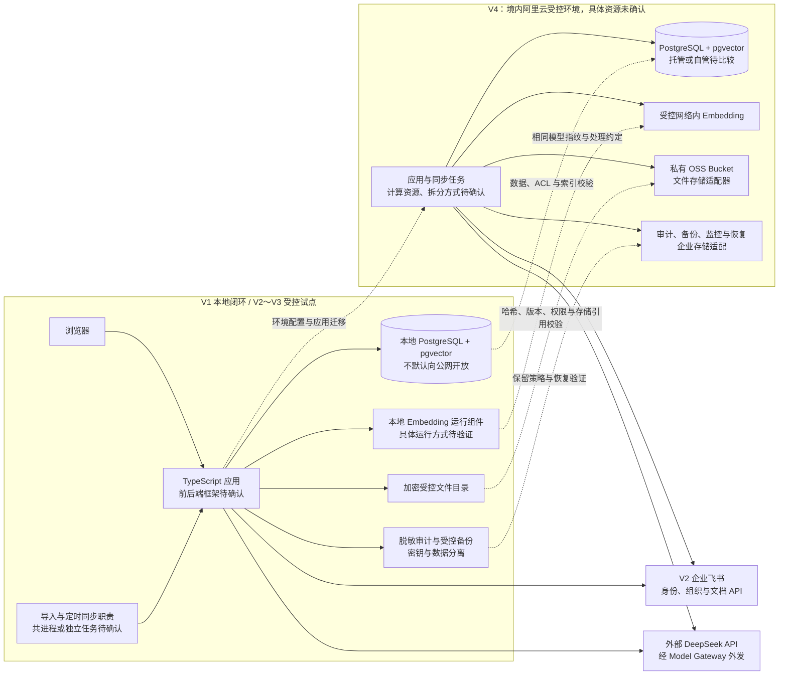

# 企业 Agent 平台 · 项目架构图

**核心要点：** V1 先做 PDF 入库与问答，V2 接飞书，V3 加只读 Agent，V4 生产化，V5 / V6 按需求增加办理与集团治理。下方完整逻辑图是企业目标视图，不是第一版必须全部实现的清单。

文档更新日期：2026-11-06。静态图：[SVG](project-architecture.svg)、[PNG](project-architecture.png)。

依据：[项目入口](../../README.md)、[协作规范](../../agent.md)、[总体架构](overview.md)、[迭代路线](../plans/iteration-roadmap.md)、[架构升级计划](evolution-plan.md)。

本文是规划视图，不是新增选型或上线授权。当前 V1～V6 均无业务实现或运行验证。

## 0. 先看首版，再看演进

第一版不实现下方图中的飞书身份与同步、完整管理台、MCP 或云资源。V4 是企业级只读生产基线，后续办理与扩域选做。

## 1. 图例与状态

- 蓝色：V1 核心与既有已确认技术路线，尚未实现。
- 橙色：支撑现有约束的逻辑职责，具体实现或治理方案待确认。
- 灰色：V2～V6 后续能力或部署扩展，不代表 V1 交付。
- 实线：主要数据流、控制流或依赖；虚线：后续能力或横切关联。
- 图中的模块不等于独立服务或进程；服务拆分、任务运行方式、框架和依赖在工程初始化时另行确认。

Skill + References 的完整领域规范安排在 V3；当前技术选择、候选和待验证事项直接在架构规划中维护。

## 2. 企业目标逻辑架构（逐版实现）

```mermaid
flowchart TB
    subgraph People["使用与维护角色"]
        Employee["V1 本机演示 / 后续员工<br/>IT 服务台只读方向"]
        Owner["资料负责人 / 维护人员"]
        Admin["平台管理员 / 安全与运维"]
    end

    subgraph Source["企业权威来源"]
        FeishuID["V2 飞书身份与组织关系"]
        FeishuDocs["V2 飞书云文档 / 知识库<br/>内容、版本与源权限"]
        Files["V1 PDF<br/>其他文件格式按需求增加"]
        Business["V3 只读 / V5 办理：业务系统"]
    end

    subgraph UI["应用入口：TypeScript，框架待确认"]
        Chat["员工问答界面<br/>答案、引用、拒答、反馈"]
        Console["建议：轻量知识管理台<br/>来源登记、上传、负责人、复审与停用"]
        Ops["管理与质量视图<br/>具体界面范围待确认"]
    end

    subgraph App["平台应用逻辑边界：不预设微服务"]
        Identity["V1 演示授权 / V2 飞书身份<br/>人员、部门、群组、文件 ACL"]
        Ingest["V1 PDF 导入 / V2 连接器同步<br/>内容、权限、版本与删除"]
        Parse["解析与索引准备<br/>结构保留、分块、中文分词"]
        Registry["知识注册与生命周期<br/>来源、归属、版本、密级、状态"]
        Policy["统一策略职责<br/>访问权限、有效版本、密级、外发"]
        Agent["首期问答编排<br/>检索、上下文、证据不足拒答、人工转交"]
        Retrieval["混合检索<br/>两路 SQL 前置过滤 → 去重 → RRF"]
        Download["受控文件读取 / 下载<br/>重新授权，不公开映射文件目录"]
        Gateway["Model Gateway<br/>高敏阻断、超时、调用管理与成本记录"]
        Skills["V3 Skill + References<br/>领域流程与渐进式资料读取"]
        MCP["V3 只读 / V5 审批后操作<br/>逐工具授权"]
    end

    subgraph Data["受控数据与计算"]
        PG[("PostgreSQL + pgvector<br/>知识元数据、组织映射、文件 ACL<br/>中文全文索引、分块向量")]
        Emb["本地中文 Embedding<br/>模型指纹与输入约定一致"]
        Store["统一文件存储接口<br/>本地加密受控目录"]
    end

    subgraph Safety["横切保障职责：基础安全不得推迟"]
        Audit["脱敏追加式会话审计<br/>会话 ID、时间戳、事件类型、格式版本"]
        Backup["受控自动备份与恢复验证<br/>数据库、文件、审计及版本一致性"]
        Quality["评测与回归<br/>召回、引用、越权、拒答、延迟、成本"]
        Monitor["运行监测与故障处理<br/>同步失败、权限失效、外部调用失败"]
    end

    DeepSeek["外部边界：DeepSeek API<br/>只接收策略允许的必要上下文"]
    OSS["后续：私有阿里云 OSS"]
    AuditSink["后续：企业审计存储适配器"]

    Employee --> Chat
    Owner --> FeishuDocs
    Owner --> Console
    Admin --> Ops
    FeishuID --> Identity
    Chat --> Identity --> Agent
    Console --> Identity
    Ops --> Identity
    Console --> Registry
    Console --> Ingest
    FeishuDocs --> Ingest
    Files --> Ingest
    Ingest --> Registry
    Ingest --> Parse
    Parse --> Emb
    Parse --> PG
    Emb --> PG
    Ingest --> Store
    Registry --> PG
    Identity --> PG
    Policy --> Registry
    Policy --> Retrieval
    Agent --> Retrieval
    Retrieval --> Emb
    Retrieval --> PG
    Agent --> Gateway
    Policy --> Gateway
    Gateway --> DeepSeek
    Agent --> Chat
    Chat --> Download
    Identity --> Download
    Download --> Store
    Store -.-> OSS
    Agent -.-> Skills
    Agent -.-> MCP
    Identity -.-> MCP
    MCP -.-> Business
    Identity -.-> Audit
    Ingest -.-> Audit
    Agent -.-> Audit
    Gateway -.-> Audit
    Download -.-> Audit
    Audit -.-> AuditSink
    PG -.-> Backup
    Store -.-> Backup
    Audit -.-> Backup
    Chat -.-> Quality
    Retrieval -.-> Quality
    Ingest -.-> Monitor
    Gateway -.-> Monitor

    classDef confirmed fill:#e8f1ff,stroke:#2563eb,color:#172554;
    classDef proposed fill:#fff4df,stroke:#b45309,color:#451a03;
    classDef future fill:#f3f4f6,stroke:#6b7280,color:#374151;
    class Employee,Files,Chat,Identity,Ingest,Parse,Registry,Agent,Retrieval,Download,Gateway,PG,Emb,Store,DeepSeek confirmed;
    class Owner,Admin,Console,Ops,Policy,Audit,Backup,Quality,Monitor proposed;
    class FeishuID,FeishuDocs,Business,Skills,MCP,OSS,AuditSink future;
```

橙色并不表示安全能力可选：审计脱敏、受控备份、高敏阻断等是项目约束，待确认的是实现方式和交付细节。图中没有新引入 Redis、消息队列、独立搜索引擎、神经重排序服务或多 Agent 系统。

## 3. V2 多入口知识接入与维护架构

### 维护责任

| 内容 | 飞书来源 | 自上传或受控本地文件 |
| --- | --- | --- |
| 内容与版本 | 部门在飞书维护，平台同步 | 部门维护文件，平台登记版本 |
| 读取权限权威来源 | 飞书有效权限；平台不得扩大 | 平台文件 ACL，配置方式待确认 |
| 人员与组织标识 | 飞书身份映射 | 同样引用飞书身份，不另建人员体系 |
| 知识范围与负责人 | 建议在平台登记来源范围与负责人 | 建议按知识集合配置默认值 |
| 密级与生命周期 | 平台治理信息与源信息协调，规则待确认 | 导入时登记，发布与复审规则待确认 |
| 同步与故障处理 | 平台负责内容、权限、删除一致性 | 平台负责导入、替换、失效和受控下载 |

“源系统维护内容、平台统一治理”及轻量管理台属于 V2 规划，具体实施范围待确认。业务域归属不等于阅读权限，例如 IT 操作指南可以允许全员阅读。

飞书 API 的有效权限覆盖范围尚未验证，不能把协作者列表或连接器身份权限直接当作员工权限。定时同步有撤权窗口；权限刷新期限、失效判定、源端复核以及无法可靠映射的权限场景，均须在接入前确定并测试。

版本发布、停用和删除需要保持正文、ACL、索引与引用一致；以上是正确性要求，不预先指定数据库事务或任务编排实现。源权限校验失败不等于源文件已删除，不能据此直接物理删除原始文件。

## 4. V2～V3 真实身份问答与权限控制链路

三条边界必须独立：

1. **访问权限**：员工是否能读取这份资料；关键词与向量两路都在数据库查询阶段过滤，不能先全库召回再删除未授权结果。
2. **知识有效性**：资料是否纳入平台、版本是否生效、ACL 是否有效、文档是否停用；有权限不等于应该用过期资料回答。
3. **模型外发许可**：获准读取不等于允许发送给 DeepSeek。严格受限内容禁止外发，自动脱敏不是首期放行依据。

检索文档、提示词和后续工具结果不能修改平台授权。References 如承载企业知识，也必须遵守相同的访问、版本和外发约束，不能因采用文件读取方式绕过权限。

引用链接不应暴露未授权文件名、内容或公开存储地址。历史会话、回答缓存和审计记录同样可能包含受控内容；访问、撤权处理和留存策略需单独设计，首期未确认引入回答缓存。

## 5. V1 本地 → V2～V3 受控试点 → V4 生产部署

V1 不接飞书，但 DeepSeek 问答仍跨出本地边界；V2 飞书接入同样跨出本地边界。迁移到境内阿里云也不自动证明模型数据驻留、保留政策或企业合规已满足。图中的试点能力按 V2 范围加入，不作为 V1 必需依赖。

迁移不是简单复制目录：必须验证文件哈希、ACL 等价性、数据库与文件版本一致性、模型指纹、索引兼容以及备份恢复。存储适配器和审计同步适配器分开设计，不承诺无成本替换。

## 6. 技术选型与实施状态

| 能力 | 当前路线 | 状态与限制 |
| --- | --- | --- |
| 首期业务 | IT 服务台只读问答、故障资料、流程指引 | 已接受；无实时工具时不能宣称实时诊断 |
| 应用语言 | TypeScript 全栈 | 已确认路线；具体框架未确认 |
| 身份与权限 | V1 显式演示权限；V2 飞书身份与文件 ACL | 企业路线已接受；有效权限映射与撤权窗口待验证 |
| 同步 | V1 手动 PDF 导入；V2 飞书定时增量同步 | 企业路线已接受；内容、权限、删除一致性待实现 |
| 数据与检索 | PostgreSQL + pgvector | 已接受；两路 SQL 前置过滤 |
| 中文关键词 | 应用侧中文分词后写入全文索引 | 已接受路线；分词器待评测 |
| Embedding | 本地受控中文模型 | 已接受路线；`BAAI/bge-small-zh-v1.5` 仅为候选 |
| 排序 | 去重 + RRF | 已接受；不是独立神经重排序 |
| 问答模型 | DeepSeek API + Model Gateway | 已接受；合规、接入配置与运行验证未完成 |
| 原始文件 | 本地受控存储，后续 OSS 适配器 | 已接受；真实资料前落实加密、授权与恢复 |
| 知识管理台 | 来源登记、上传、负责人、复审、停用 | 建议，未确认界面范围及治理规则 |
| 会话审计与备份 | 脱敏追加式事件、受控加密存储与适配 | 项目约束；尚未实现，不宣称已自动记录 |
| 评测与监控 | V1 演示题；V2 / V3 真实问题积累；V4 正式验收 | 按版本验证；正式阈值待确认 |
| Skill + References | 结构化领域流程与渐进式读取 | V3 规划；具体规范待确认 |
| MCP 与实时查询 | 独立授权的业务工具网关 | 后续计划；首期不默认接入 |
| 多业务域与子公司隔离 | 共享平台下的领域治理方向 | 后续计划；隔离方式需单独决策 |
| 云端部署 | 境内阿里云 | 已接受方向；地域、资源、容量、网络未确定 |

## 7. 仍需确认的关键问题

- 自上传文件 ACL 的配置、继承和审批方式；是否优先将适合的文件放入受管飞书目录。
- 管理台首期范围、知识发布权限、负责人和复审规则；不将部门归属直接当成可读范围。
- 飞书 API 对有效权限的覆盖，身份与群组刷新、权限缓存失效及撤权生效时间。
- V1 的约 10 个演示问题；V2～V4 的真实问题集、同步时效及正式验收阈值。
- V1 的前后端框架及 Embedding 运行组件；V2 同步任务运行方式。
- 本地静态加密、密钥保管、审计保留、备份一致性与恢复流程。
- DeepSeek 数据合规，以及阿里云具体资源、数据库方式和生产安全门槛。

这些未定项不妨碍理解完整逻辑架构，但决定实际实施和生产上线方式。本文不把候选标为已确认或把规划标为已实现，也不授权安装依赖、创建云资源或接入真实企业资料。
