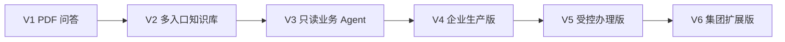

# 企业 Agent 平台 · 版本迭代路线

**核心要点：** 先让几份 PDF 真正完成问答，再增加资料入口、业务能力和企业治理。每一版都能单独使用，不要求先建设完整企业平台才开始验证。

更新日期：2026-11-09。当前进入 V1 实施，网页工程初始化完成，V1 业务及 V2～V6 未完成；后续版本是规划目标，不是供应商、费用、上线或开发执行授权。

## 1. 一眼看懂路线

| 版本 | 这一版解决什么 | 用户能得到什么 | 架构变化 |
| --- | --- | --- | --- |
| V1：PDF 问答 | 先把项目跑起来 | 上传 PDF，提问，看答案、页码和原文 | 本地应用 + 数据库 + 本地向量模型 |
| V2：多入口知识库 | 不再靠手动上传维护所有资料 | 飞书登录，接入飞书文档，按权限查询最新资料 | 增加连接器、同步任务、身份与有效权限映射 |
| V3：只读业务 Agent | 从“查资料”变成“按流程帮助处理问题” | 按 IT 流程澄清、排查，查询获准的实时业务状态 | 增加 Skill、References 和受限只读工具 |
| V4：企业生产版 | 从可用试点变成可运营服务 | 受控云部署、稳定运行、可审计、可恢复 | 云环境、独立任务按需部署、监控与持续评测 |
| V5：受控办理版 | 不只告诉用户怎么做，还能获准代办 | 经确认和审批创建工单或执行低风险操作 | 增加操作授权、审批、幂等和异常处置 |
| V6：集团扩展版 | 支持更多业务域与子公司 | IT、HR 等领域 Agent，统一治理与隔离 | 多域治理；按实测瓶颈拆服务或扩容 |

V4 可作为企业级知识与只读 Agent 的首次生产交付；企业不需要代办时可以停在 V4。V5、V6 是按业务需求扩展，不是所有项目都必须完成的前置条件。



版本顺序表示默认交付路线，不表示安全可以延后。远程多人试点需要的网络、身份、监控等能力须提前从 V4 引入；若只需知识问答，可以跳过 V3 的实时工具范围，先完成 V4 生产化。

## 2. V1 · PDF 问答本地版

**目标**：用 3～5 份无敏感信息 PDF，把资料入库到回答的全过程跑通。

**交付内容**：

- PDF 上传、处理状态、失败提示、重复文件识别与删除。
- 按页提取文字、分块、生成本地向量，保存资料、索引与来源。
- 关键词与向量混合检索，DeepSeek 基于必要片段回答。
- 答案展示文件名、物理页码和原文；无依据时明确说明。
- 本地启动说明及约 10 个从演示 PDF 中挑选的问题。

**架构**：TypeScript 模块化应用、PostgreSQL + pgvector、本地中文 Embedding、本地受控文件目录；已确认 Next.js 同工程配本地轻量计算进程，目前仅网页骨架完成。保留统一文档接口，不开发飞书连接器。选型对比、数据结构与运行边界见 [V1 技术架构方案](../architecture/evolution-plan.md#8-v1-技术架构方案)。

**不做**：扫描件 OCR、复杂表格理解、飞书登录、多部门后台、实时业务查询、自动办理、云部署、100 条真实问题采集。

**安全边界**：仅本机单人演示，固定测试身份与显式文件可见范围；问题和上下文执行外发策略，凭据只保存在服务端，日志脱敏。演示不开放公网，不使用未授权真实资料。

**完成条件**：3 份 PDF 入库成功，内容重启后仍在；约 10 个问题逐题核对答案、事实支持、页码与原文；无答案、来源冲突、重复上传、扫描件和外部模型失败都有明确结果。处理中重启可恢复，处理中删除不能重新发布；删除后旧引用及历史会话不能继续读取原文。引用 ID 存在不等于事实有支持，演示题不冒充真实评测题。

**实施顺序**：工程与数据库初始化、中文 PDF / 本地模型兼容验证 → PDF 提取、分块和持久任务入库 → 检索、问答与来源页面 → 演示问题、安全及失败场景验证。依赖和模型参数先实验再锁定，不因写入方案而视为已选定。

**升级前要看**：主链路已可复现，PDF 提取质量可接受；确实出现飞书资料维护或多人访问需求。

## 3. V2 · 多入口知识库

**目标**：PDF 与飞书文档进入同一知识库，资料更新和用户权限不再靠手动约定。

**交付内容**：

- 飞书登录、人员及必要组织 / 群组映射；上传文件的权限绑定真实身份。
- 先接一个获准飞书目录或知识范围，保留 PDF 入口。
- 定时增量同步内容、版本、权限、删除；失败重试、同步状态和问题处理入口。
- 简单知识管理页：资料来源、可见范围、更新状态、停用。
- 在受控条件下由少量获准用户验证真实资料问答，规模由业务与安全负责人确认。

**架构变化**：入口连接器转换成统一文档；后面的分块、入库、检索、问答复用。导入任务必须可持久登记和失败恢复；是否独立 Worker 以任务是否影响问答为依据，不强制引入消息队列。

**不做**：同时接所有资料格式和所有企业系统；部门归属不能直接当作阅读权限。Word、Markdown、Excel 和 OCR 按资料需求逐个添加并验证，不默认全部支持。

**完成条件**：同一问题可引用不同入口；内容更新与删除能正确反映；不同身份看见的资料符合源权限；撤权后不能靠缓存、旧引用或历史上下文继续读取。连接器账户能读取的资料不代表所有员工都能读取。

**安全前置**：真实资料启用前完成授权、静态加密、密钥分离、受控备份和恢复验证；实现必要的脱敏追加式审计。飞书权限无法可靠映射的场景先隔离，不等待后续版本补救。

**升级前要看**：真实试点显示资料问答不足以解决部分问题，需要固定排查流程或实时只读证据；不得因为计划写了 V3 就接入无实际用途的工具。

## 4. V3 · 只读业务 Agent

**目标**：围绕 IT 服务台，把资料问答升级成有流程、有证据的只读协助。

**交付内容**：

- 首个 IT Skill：明确何时问资料、何时澄清、何时查实时状态、何时转人工。
- References 保存获准的流程和手册，按需要读取，仍检查权限、版本及外发策略。
- 接入一个有实际用途的只读 API / MCP 工具，如获准的工单状态查询。
- 展示工具结果的来源、时间和失败原因，不把模型推测写成查询事实。
- 工具允许清单、参数校验、逐次授权、超时和脱敏调用审计。

**架构变化**：问答编排可选择检索或受限只读工具；工具网关是逻辑边界，不一定独立部署。Memory 只保存必要的会话状态，不成为绕过当前权限的知识缓存。

**不做**：自动修复数据、修改权限、提交业务写入；模型不持有任意 SQL 或无限制工具访问。

**完成条件**：资料型、需要澄清、实时查询和转人工四类问题走正确路径；工具无权限或失败时不会假称查询成功；恶意文档不能触发越权工具调用。

**升级前要看**：真实只读试点达到确认的质量标准，并有企业部署、可用性或多人服务需求。若工具并非刚需，可保留该版为选做范围，先推进生产化。

## 5. V4 · 企业生产版

**目标**：把已验证的知识问答 / 只读 Agent 部署成可持续运营的企业服务。

**交付内容**：

- 境内阿里云受控环境、域名与 TLS、网络与密钥管理、开发测试生产环境隔离。
- 数据库、文件和审计存储迁移与校验；受控文件通过私有存储和授权接口访问。
- 监控告警、限流、用户 / 应用预算、模型调用超时、重试上限与故障降级。
- 完整会话审计和受控自动备份，明确保留与删除规则；完成恢复演练。
- 部署自动化、变更检查、灰度和回滚、值班责任、故障处理说明。
- 按真实业务问题建设持续评测和安全回归；质量、性能、费用及恢复目标经负责人确认。

**架构变化**：优先保留模块化应用，在任务互相影响时独立部署 Worker；比较托管数据库与自管数据库，验证 pgvector 兼容性；文件按确认方案迁移到私有 OSS。

**不做**：仅为“企业级”名称引入 Kubernetes、微服务、独立搜索或多 Agent。

**上线门槛**：数据外发合规、安全审查、权限回归、备份恢复、实测容量、成本预算、灰度和故障处置全部有证据。明确峰值并发、p95、错误率、可接受数据丢失量和恢复时长；值未确认前不宣称满足 SLA。

**完成条件**：在获准真实用户范围内通过验收并可恢复、可运维；不把“部署成功”当作“生产通过”。这是企业级只读 Agent 的基线交付。

## 6. V5 · 受控业务办理

**目标**：从提供建议升级为在明确授权下代办少量低风险事务。

**交付内容**：

- 首先选一个可审计、可幂等的操作，例如创建工单，单独确认业务授权。
- 执行前展示动作、目标及影响，要求确认；需要审批的动作走可信审批流程。
- 绑定实际操作人、目标对象、参数和有效期；批准后再校验当前权限。
- 幂等键、重复点击和重试保护、操作状态查询与结果审计。
- 对超时未知结果先查询状态，不盲目再次写入；失败提供人工接管。

**架构变化**：工具层增加受控命令执行与持久操作状态；对复杂长流程再比较现有审批集成与流程引擎，不提前自建通用工作流。

**不做**：无确认的高风险修改、模型自行批准自身操作、未经授权的直接数据库写入。

**完成条件**：重复请求不重复办理；审批不可跨对象或修改参数复用；撤权后已批准操作也不可继续执行；失败能确认结果或转人工。

**回退原则**：禁用写工具立即恢复只读服务。已产生的业务副作用不能靠代码回滚撤销；仅在业务允许且另获授权时执行补偿，否则人工处理。

## 7. V6 · 集团扩展与长期演进

**目标**：在已有运营证据基础上支持多业务域、多子公司和更大使用规模。

**交付内容**：

- 从 IT 扩展一个第二业务域，再推广到更多域；每域有资料、流程和安全负责人。
- 知识域、组织范围、工具、会话、日志与备份都具有隔离规则；跨域访问必须明确授权。
- Skill、References 和工具的发布、版本、停用与复审流程。
- 按域统计质量、流量、费用、容量、故障与服务目标。
- 灰度发布新域、新模型与新索引，验证后再扩大用户范围。

**架构变化**：先比较共享平台隔离与独立实例，依据法规、故障影响和资源争用决定。只有可重复瓶颈才引入专用搜索、重排序、事件同步、服务拆分或多 Agent。

**完成条件**：至少两个域和对应身份完成隔离及回归验证；新域上线有负责人和恢复方案；负载及成本达到确认的目标。约 4000 员工不是 4000 并发，容量按实测使用模型确定。

## 8. 架构升级与迁移原则

详见 [架构升级计划](../architecture/evolution-plan.md)。每次升级都执行同一条短流程：

```text
发现实际需求或瓶颈 → 比较继续优化与替代方案 → 小范围验证
→ 用户确认决策与预算 → 数据和权限校验 → 灰度 → 回退演练 → 扩大范围
```

| 升级 | 必须保持的内容 | 失败时怎么处理 |
| --- | --- | --- |
| PDF → 多入口 | 统一文档、来源定位、版本、权限及外发策略 | 停用新连接器，PDF 入口继续工作；隔离错误同步内容 |
| 固定身份 → 飞书身份 | 测试资料不能因映射遗漏变为全员可读 | 未映射默认拒绝；试点入口关闭，不回退为公共访问 |
| 共部署 → 独立任务 | 持久任务 ID、幂等与版本发布规则 | 暂停任务并校验状态，不让两个执行器重复消费 |
| 本地 → 云端 | 文件哈希、数据库、ACL、审计、模型指纹与恢复链路 | 先演练切回；云端有新数据后需核对并回迁，不能切回旧库丢数据 |
| 只读 → 写入 | 读取能力与操作授权分开 | 关闭写入，保留只读；已完成副作用按业务处置 |
| 单域 → 多域 | 查询、工具、会话、缓存、日志与备份的隔离 | 停用新域并阻断跨域访问，不回退为全库共享 |

模型、搜索和存储适配器用于减少业务耦合，不意味着无成本迁移。模型升级可能重建向量；搜索升级必须证明 ACL 等价；文件升级须迁移并校验内容及权限。

## 9. 如何管理阶段与评测

- 每版开始只确认该版的简短实施范围、依赖、验证方式和费用边界，不提前执行后续版本。
- V1 只做演示 PDF 功能检查；V2 / V3 从真实试点失败问题逐步积累样本；V4 再形成正式评测与持续回归。
- 真实问题规模随试点范围确认，不设为工程初始化或 V1 前置门槛。
- 基础权限、外发阻断和日志脱敏从 V1 开始；使用真实资料所需加密与授权在启用前落实。
- 每版完成后更新本路线的当前状态、验证结果、已知限制和下一版条件，不默认新增独立历史迭代文档。未运行的测试、未接入的服务和未实现的能力明确标注。

## 10. 当前执行状态

- [x] 确认 V1 框架、具体实现范围并授权编码：仅工程初始化 2.1～2.3 及本阶段依赖安装。
- [ ] V1 PDF 问答本地版。
- [ ] V2 多入口知识库。
- [ ] V3 只读业务 Agent。
- [ ] V4 企业生产版。
- [ ] V5 受控业务办理（按需求）。
- [ ] V6 集团扩展（按需求）。

已确认 [V1 技术架构方案](../architecture/evolution-plan.md#8-v1-技术架构方案)，未改变版本顺序。工程初始化 2.1～2.3 已完成，5 个页面测试、类型检查、lint、构建与本地开发 / 生产浏览器验证通过；详细记录见 [工程与兼容验证计划](2026-11-07-v1-engineering-compatibility.md)。数据库、PDF、本地模型和计算进程尚未接入，下一步由用户指定。

没有承诺交付日期、供应商价格或容量；具体工期取决于 PDF 类型、已有运行环境、接口权限、实施资源及试点反馈。当前只有网页工程骨架，PDF 问答业务和模型服务调用未实现或执行。
