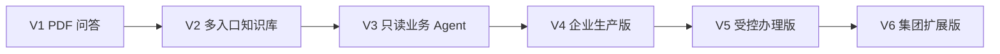

# 企业 Agent 平台 · 版本迭代路线

**核心要点：** 先做 PDF 上传和资料列表，再让系统读取资料，最后接通问答。每一步先说明“做什么、你能看到什么”，技术接入服务于功能，不单独堆一轮架构任务。

更新日期：2026-11-09。当前进入 V1 实施，网页工程初始化完成，V1 业务及 V2～V6 未完成；后续版本是规划目标，不是供应商、费用、上线或开发执行授权。

## 1. 一眼看懂路线

| 版本 | 做什么 | 你能看到什么 |
| --- | --- | --- |
| V1：PDF 问答 | 上传、读取 PDF，再根据资料回答 | 资料列表、答案、页码和原文 |
| V2：多入口知识库 | 用飞书登录，接入并更新飞书资料 | PDF 和飞书资料一起查询，只看到有权阅读的内容 |
| V3：只读业务 Agent | 按 IT 流程提供帮助，查询获准业务状态 | 排查步骤、实时查询结果或转人工提示 |
| V4：企业生产版 | 让获准员工稳定使用，能追踪问题和恢复数据 | 企业访问入口、运行状态、审计与恢复结果 |
| V5：受控办理版 | 经确认和审批办理一个低风险事项 | 操作确认、审批进度和办理结果 |
| V6：集团扩展版 | 增加业务域和子公司，保持数据隔离 | IT、HR 等业务入口，各自权限和使用情况 |

V4 可作为企业级知识与只读 Agent 的首次生产交付；企业不需要代办时可以停在 V4。V5、V6 是按业务需求扩展，不是所有项目都必须完成的前置条件。



版本顺序表示默认交付路线，不表示安全可以延后。远程多人试点需要的网络、身份、监控等能力须提前从 V4 引入；若只需知识问答，可以跳过 V3 的实时工具范围，先完成 V4 生产化。

## 2. V1 · PDF 问答本地版

**目标**：用 3～5 份无敏感信息 PDF，把资料入库到回答的全过程跑通。
**当前进度**：工程骨架已完成，下面的功能均未实现。下一步先做上传和资料列表，详见 [V1 功能计划](2026-11-07-v1-engineering-compatibility.md)。

**功能顺序**：

1. **上传和资料列表**：能上传、保存和删除 PDF，刷新或重启后资料仍在。
2. **读取并保存资料**：能查看提取的文字和处理状态，知道资料是否已准备好。
3. **提问和查看来源**：输入问题，看答案、文件名、页码和原文；无依据时明确说明。
4. **完整试用检查**：用 3 份 PDF 和约 10 个问题，检查整个流程及失败提示。

<details>
<summary>V1 的技术配套、安全边界和验收细节</summary>

**架构**：TypeScript 模块化应用、PostgreSQL + pgvector、本地中文 Embedding、本地受控文件目录；已确认 Next.js 同工程配本地轻量计算进程，目前仅网页骨架完成。保留统一文档接口，不开发飞书连接器。选型对比、数据结构与运行边界见 [V1 技术架构方案](../architecture/evolution-plan.md#8-v1-技术架构方案)。

**不做**：扫描件 OCR、复杂表格理解、飞书登录、多部门后台、实时业务查询、自动办理、云部署、100 条真实问题采集。

**安全边界**：仅本机单人演示，固定测试身份与显式文件可见范围；问题和上下文执行外发策略，凭据只保存在服务端，日志脱敏。演示不开放公网，不使用未授权真实资料。

**完成条件**：3 份 PDF 入库成功，内容重启后仍在；约 10 个问题逐题核对答案、事实支持、页码与原文；无答案、来源冲突、重复上传、扫描件和外部模型失败都有明确结果。处理中重启可恢复，处理中删除不能重新发布；删除后旧引用及历史会话不能继续读取原文。引用 ID 存在不等于事实有支持，演示题不冒充真实评测题。

**技术如何配合功能**：上传时接数据库和文件保存；读取资料时验证 PDF、分词、本地模型并建立搜索内容；问答时接混合搜索和模型调用。兼容性在对应功能中验证，依赖和参数先验证再锁定。

**升级前要看**：主链路已可复现，PDF 提取质量可接受；确实出现飞书资料维护或多人访问需求。

</details>

## 3. V2 · 多入口知识库

**目标**：PDF 与飞书文档进入同一知识库，资料更新和用户权限不再靠手动约定。

**功能顺序**：

1. **飞书登录**：员工用真实身份登录，只能看到自己有权阅读的资料。
2. **接入飞书资料**：先接一个获准目录，在列表中看到 PDF 和飞书文档。
3. **保持资料更新**：看到同步状态和失败提示，内容变更、删除及撤权能正确生效。
4. **小范围试用**：让获准员工实际查询，核对答案和阅读权限。

<details>
<summary>V2 的技术配套、安全边界和验收细节</summary>

**架构变化**：入口连接器转换成统一文档；后面的分块、入库、检索、问答复用。导入任务必须可持久登记和失败恢复；是否独立 Worker 以任务是否影响问答为依据，不强制引入消息队列。

**不做**：同时接所有资料格式和所有企业系统；部门归属不能直接当作阅读权限。Word、Markdown、Excel 和 OCR 按资料需求逐个添加并验证，不默认全部支持。

**完成条件**：同一问题可引用不同入口；内容更新与删除能正确反映；不同身份看见的资料符合源权限；撤权后不能靠缓存、旧引用或历史上下文继续读取。连接器账户能读取的资料不代表所有员工都能读取。

**安全前置**：真实资料启用前完成授权、静态加密、密钥分离、受控备份和恢复验证；实现必要的脱敏追加式审计。飞书权限无法可靠映射的场景先隔离，不等待后续版本补救。

**升级前要看**：真实试点显示资料问答不足以解决部分问题，需要固定排查流程或实时只读证据；不得因为计划写了 V3 就接入无实际用途的工具。

</details>

## 4. V3 · 只读业务 Agent

**目标**：围绕 IT 服务台，把资料问答升级成有流程、有证据的只读协助。

**功能顺序**：

1. **按流程提供帮助**：围绕一个 IT 场景，给出排查步骤，需要时先询问补充信息。
2. **查询一个真实状态**：例如查询获准的工单状态，显示结果来源和查询时间。
3. **提供失败和转人工提示**：无权限或查询失败时说明原因，不假称查到了结果。
4. **实际试用**：检查资料问答、补充提问、状态查询和转人工是否走对流程。

<details>
<summary>V3 的技术配套、安全边界和验收细节</summary>

**架构变化**：问答编排可选择检索或受限只读工具；工具网关是逻辑边界，不一定独立部署。Memory 只保存必要的会话状态，不成为绕过当前权限的知识缓存。
技术配套包括首个 IT Skill、获准流程 References、一个只读 API / MCP、工具允许清单、参数校验、逐次授权、超时与脱敏审计。

**不做**：自动修复数据、修改权限、提交业务写入；模型不持有任意 SQL 或无限制工具访问。

**完成条件**：资料型、需要澄清、实时查询和转人工四类问题走正确路径；工具无权限或失败时不会假称查询成功；恶意文档不能触发越权工具调用。

**升级前要看**：真实只读试点达到确认的质量标准，并有企业部署、可用性或多人服务需求。若工具并非刚需，可保留该版为选做范围，先推进生产化。

</details>

## 5. V4 · 企业生产版

**目标**：把已验证的知识问答 / 只读 Agent 部署成可持续运营的企业服务。

**功能顺序**：

1. **企业访问入口**：获准员工能安全访问，完成资料、身份和权限迁移核对。
2. **运行状态和使用限制**：管理员能发现故障、收到告警，控制调用费用。
3. **审计和备份恢复**：能追踪脱敏后的交互与操作，验证备份确实能恢复。
4. **上线验收**：用真实工作负载检查质量、安全、容量、成本和故障处理。

<details>
<summary>V4 的技术配套、安全边界和验收细节</summary>

**架构变化**：优先保留模块化应用，在任务互相影响时独立部署 Worker；比较托管数据库与自管数据库，验证 pgvector 兼容性；文件按确认方案迁移到私有 OSS。
技术配套包括境内阿里云受控部署、TLS、环境隔离、私有存储、网络与密钥管理、限流预算、超时降级、监控告警、脱敏审计、自动备份及保留删除规则、部署回滚、运维责任和持续质量检查。

**不做**：仅为“企业级”名称引入 Kubernetes、微服务、独立搜索或多 Agent。

**上线门槛**：数据外发合规、安全审查、权限回归、备份恢复、实测容量、成本预算、灰度和故障处置全部有证据。明确峰值并发、p95、错误率、可接受数据丢失量和恢复时长；值未确认前不宣称满足 SLA。

**完成条件**：在获准真实用户范围内通过验收并可恢复、可运维；不把“部署成功”当作“生产通过”。这是企业级只读 Agent 的基线交付。

</details>

## 6. V5 · 受控业务办理

**目标**：从提供建议升级为在明确授权下代办少量低风险事务。

**功能顺序**：

1. **选择一个办理事项**：例如创建工单，先确认允许代办的范围。
2. **确认和审批**：执行前看到具体操作及影响，确认后按要求审批。
3. **查看办理结果**：看到状态和结果，重复点击不会重复办理。
4. **异常处理**：结果不确定时先查询状态，失败时能转人工。

<details>
<summary>V5 的技术配套、安全边界和验收细节</summary>

**架构变化**：工具层增加受控命令执行与持久操作状态；对复杂长流程再比较现有审批集成与流程引擎，不提前自建通用工作流。
授权绑定实际操作人、目标对象、参数和有效期；审批后重新校验权限。通过幂等键、状态查询和结果审计防止重复操作，结果未知时不得盲目重试。

**不做**：无确认的高风险修改、模型自行批准自身操作、未经授权的直接数据库写入。

**完成条件**：重复请求不重复办理；审批不可跨对象或修改参数复用；撤权后已批准操作也不可继续执行；失败能确认结果或转人工。

**回退原则**：禁用写工具立即恢复只读服务。已产生的业务副作用不能靠代码回滚撤销；仅在业务允许且另获授权时执行补偿，否则人工处理。

</details>

## 7. V6 · 集团扩展与长期演进

**目标**：在已有运营证据基础上支持多业务域、多子公司和更大使用规模。

**功能顺序**：

1. **增加一个业务入口**：从 IT 扩展到 HR 等第二个领域，各有资料和负责人。
2. **检查数据隔离**：不同领域和子公司的用户只能访问获准内容。
3. **管理各域使用情况**：看到质量、流量、费用和故障，能发布或停用新能力。
4. **逐步推广**：小范围验证通过后，再增加业务域和用户。

<details>
<summary>V6 的技术配套、安全边界和验收细节</summary>

**架构变化**：先比较共享平台隔离与独立实例，依据法规、故障影响和资源争用决定。只有可重复瓶颈才引入专用搜索、重排序、事件同步、服务拆分或多 Agent。
隔离覆盖知识、工具、会话、日志及备份；跨域访问单独授权。Skill、References 和工具需有版本、发布、停用和复审流程，新域、模型与索引先小范围验证。

**完成条件**：至少两个域和对应身份完成隔离及回归验证；新域上线有负责人和恢复方案；负载及成本达到确认的目标。约 4000 员工不是 4000 并发，容量按实测使用模型确定。

</details>

## 8. 架构升级与迁移原则

这些是开发时的技术参考，不是要提前全部完成的功能清单。

<details>
<summary>需要升级或迁移时再查看</summary>

详见 [架构升级计划](../architecture/evolution-plan.md)。每次升级都执行同一条短流程：

```text
发现实际需求或瓶颈 → 比较继续优化与替代方案 → 小范围验证
→ 用户确认决策与预算 → 数据和权限校验 → 灰度 → 回退演练 → 扩大范围
```

| 升级 | 必须保持的内容 | 失败时怎么处理 |
| --- | --- | --- |
| PDF → 多入口 | 统一文档、来源定位、版本、权限及外发策略 | 停用新连接器，PDF 入口继续工作；隔离错误同步内容 |
| 固定身份 → 飞书身份 | 测试资料不能因映射遗漏变为全员可读 | 未映射默认拒绝；试点入口关闭，不回退为公共访问 |
| 共部署 → 独立任务 | 持久任务 ID、幂等与版本发布规则 | 暂停任务并校验状态，不让两个执行器重复消费 |
| 本地 → 云端 | 文件哈希、数据库、ACL、审计、模型指纹与恢复链路 | 先演练切回；云端有新数据后需核对并回迁，不能切回旧库丢数据 |
| 只读 → 写入 | 读取能力与操作授权分开 | 关闭写入，保留只读；已完成副作用按业务处置 |
| 单域 → 多域 | 查询、工具、会话、缓存、日志与备份的隔离 | 停用新域并阻断跨域访问，不回退为全库共享 |

模型、搜索和存储适配器用于减少业务耦合，不意味着无成本迁移。模型升级可能重建向量；搜索升级必须证明 ACL 等价；文件升级须迁移并校验内容及权限。

</details>

## 9. 如何管理阶段与评测

- 后续计划统一按“做什么 → 你能看到什么 → 怎么确认完成 → 下一步”编写，先列 3～5 个功能步骤；文件清单、技术验证和选型细节放在后面或折叠区。
- 每次只推进用户指定的功能；说明需要的依赖、数据操作和费用边界，不提前执行后续版本。数据库、解析和模型接入归到使用它们的功能中。
- V1 只做演示 PDF 功能检查；V2 / V3 从真实试点失败问题逐步积累样本；V4 再形成正式评测与持续回归。
- 真实问题规模随试点范围确认，不设为工程初始化或 V1 前置门槛。
- 基础权限、外发阻断和日志脱敏从 V1 开始；使用真实资料所需加密与授权在启用前落实。
- 每版完成后更新本路线的当前状态、验证结果、已知限制和下一版条件，不默认新增独立历史迭代文档。未运行的测试、未接入的服务和未实现的能力明确标注。

## 10. 当前执行状态

- [x] 工程骨架：原工程初始化 2.1～2.3 已完成。
- [ ] 下一步：PDF 上传和资料列表。
- [ ] V1 PDF 问答本地版。
- [ ] V2 多入口知识库。
- [ ] V3 只读业务 Agent。
- [ ] V4 企业生产版。
- [ ] V5 受控业务办理（按需求）。
- [ ] V6 集团扩展（按需求）。

已确认 [V1 技术架构方案](../architecture/evolution-plan.md#8-v1-技术架构方案)，未改变 V1～V6 版本顺序。工程骨架已完成，5 个页面测试、类型检查、lint、构建与本地开发 / 生产浏览器验证通过；已有记录保留在 [V1 功能计划](2026-11-07-v1-engineering-compatibility.md) 的折叠区。数据库、PDF、本地模型和计算进程尚未接入；本次只调整文档，下一步由用户指定“上传和资料列表”后执行。

没有承诺交付日期、供应商价格或容量；具体工期取决于 PDF 类型、已有运行环境、接口权限、实施资源及试点反馈。当前只有网页工程骨架，PDF 问答业务和模型服务调用未实现或执行。
